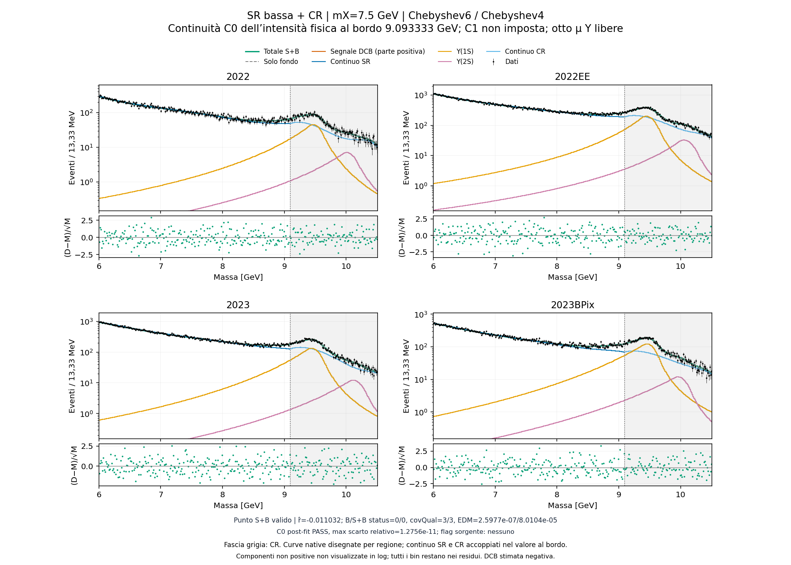
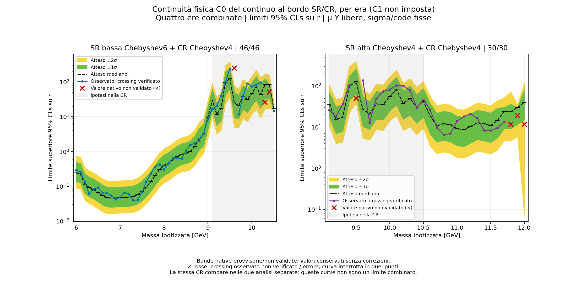
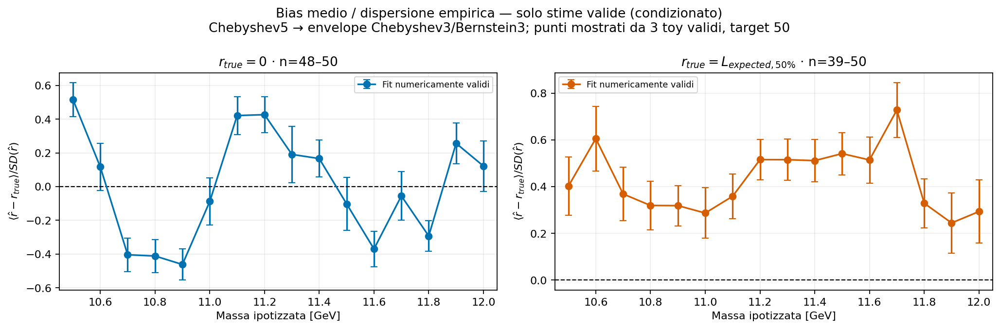
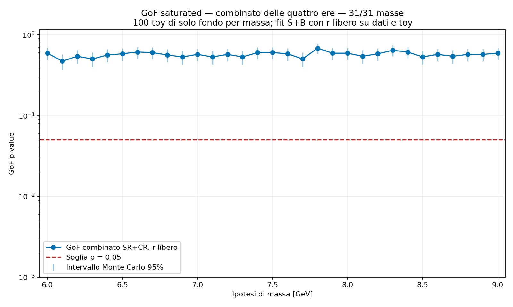

# Analisi Xee: guida operativa al fit simultaneo

2 novembre 2026. Configurazione di riferimento, risultati più recenti e istruzioni per riprodurre l'analisi.

## 1. Configurazione di riferimento

**Configurazione concordata; validazione statistica ancora incompleta.**

[SCHEMA_CONFIGURAZIONE]

Due analisi separate: SR bassa+CR e SR alta+CR. Ciascuna combina quattro ere, con otto canali. La CR contiene gli stessi dati nelle due analisi: i risultati sono correlati e non si combinano contando due volte quegli eventi.

In ogni regione: continuo + Υ(1S) + Υ(2S) + segnale DCB. Medie e rese Υ libere; larghezze e code MC fisse. Segnale presente anche nella CR, con un unico r. Coefficienti del continuo liberi; raccordo esatto C0 della densità. Binning originale, nessun envelope.

**Manca / da rifare:** bias, copertura e GoF propri del modello C0 finale. I toy storici non lo validano automaticamente.

<!-- PAGE -->

## 2. Componenti e significato delle rese

Per ogni era e regione l'intensità è la somma di quattro processi:

```text
lambda(m) = Ncontinuo * pcontinuo(m)
          + NY1 * pY1(m) + NY2 * pY2(m)
          + Nsegnale(r,nuisance) * psegnale(m)
```

Le PDF sono normalizzate nella rispettiva regione. La likelihood contiene ogni canale e ciascuno dei dieci vincoli ausiliari originali una sola volta.

**Continuo.** `P(t)=1+sum(c_k*T_k(t))`, con t su [-1,1] riscalato separatamente in ciascuna regione. Gli stessi coefficienti su intervalli diversi non darebbero la stessa curva in massa. Limiti numerici: c1 in [-2,2], altri coefficienti in [-1,1]. La positività è richiesta su 257 punti durante il fit e verificata esattamente agli estremi e punti stazionari dopo il fit.

**Υ(1S)/Υ(2S).** Larghezze e quattro parametri di coda DCB fissati al MC; otto medie libere entro ±0,2 GeV dalla media MC; otto scale libere in [0,10]. Medie e scale sono condivise SR-CR nella stessa era. La scala non è un numero di eventi: moltiplica la resa nominale e la frazione accettata.

**Segnale.** DCB originale per massa ed era; r comune moltiplica le rese del workspace. Non rappresenta direttamente eventi né una sezione d'urto assoluta. Le nuisance originali possono modificare forma e resa; la gaussiana semplice appartiene soltanto a prove storiche.

**Trasferimento regionale**, per Υ e segnale:

```text
A_R(theta) = integrale_R f / integrale_[6,12] f
N_R(theta) = N_[6,12](theta) * A_R(theta)
```

Gli integrali analitici vengono aggiornati con medie e nuisance. Non si rinormalizza al 100% nelle sole regioni selezionate: la frazione nell'altra SR resta esclusa da quell'analisi.

**Nuisance originali:** identificazione, ricostruzione e trigger elettronico; due componenti di luminosità; scala elettronica; quattro nuisance di larghezza del segnale. Le correlazioni seguono i nomi originali. Un fit precedente agli stessi dati fornisce inizializzazioni, non nuove prior sui parametri del fondo.

**Assunzione concordata:** forme Υ del MC considerate valide; larghezze e code restano fisse. **Manca / da rifare:** verificare l'identificabilità dei componenti nel modello combinato; la convergenza da sola non la dimostra.

<!-- PAGE -->

## 3. Raccordo C0 e likelihood: implementazione effettiva

C0 significa uguaglianza della **densità fisica di eventi** al confine, non uguaglianza delle PDF regionali da sole. Chiamando P i polinomi non normalizzati e I i rispettivi integrali, per ogni era si costruisce:

```text
p_SR = P_SR / I_SR             p_CR = P_CR / I_CR
N_SR = N_CR * P_CR(confine) * I_SR / [P_SR(confine) * I_CR]
N_SR * p_SR(confine) = N_CR * p_CR(confine)
```

N_CR è un parametro libero; N_SR è una `RooFormulaVar` usata come coefficiente del continuo nella `RooAddPdf` della SR. Gli otto canali entrano nel medesimo `RooSimultaneousOpt`. A ogni passo, Combine varia i parametri liberi e ricalcola il rapporto: **il raccordo è dentro il modello durante il fit**, non una correzione grafica successiva. Si elimina una normalizzazione indipendente per era. Non si aggiunge una penalità gaussiana, non si fissano i coefficienti e non si raccorda la pendenza C1.

Il workspace memorizza i conteggi come `RooDataSet` pesato ai centri dei bin, con likelihood estesa. Le curve diagnostiche usano `N*p(centro)*larghezza_bin`; il termine esteso usa invece la resa analitica. Non è una nuova likelihood esattamente integrata bin per bin. Gli integrali **regionali** delle DCB e delle rese restano analitici. Alcuni studi CR preliminari usavano integrali di bin con iminuit: i rispettivi score non sono intercambiabili.

Per confrontare minimi e inizializzazioni si usa una devianza assoluta coerente:

```text
D = 2 * [N_atteso - N_osservato
         + somma_bin n_i * log(n_i / nu_i_al_centro)]
    + somma dei dieci termini ausiliari gaussiani
```

Il termine con n_i=0 vale zero. Lo score viene ricalcolato sullo stesso modello e sugli stessi dati. Valori `minNll` con offset differenti, score da figure o istogrammi rinormalizzati non forniscono questo confronto.

I bin hanno larghezza 13,333 MeV: 232 nella SR bassa, 106 nella CR e 112 nella SR alta per era. La selezione assegna ogni centro di bin a una sola regione. Gli input originali e i conteggi restano immutati; i vincoli ausiliari vengono inseriti una sola volta.

**Manca / da rifare:** validare l'accuratezza della valutazione ai centri ai fini dell'inferenza finale. La positività durante il fit è controllata su 257 punti; il controllo finale agli estremi e punti stazionari è indispensabile. Non basta controllare il solo grafico.

<!-- PAGE -->

## 4. Scelta di intervalli e funzioni

**CR.** Si sono confrontate finestre attorno alle due Υ, da 8,8-10,8 GeV a intervalli più stretti, allineando i bordi ai bin originali. Per confrontarle si sono valutate anche le rese delle code in intervalli esterni comuni: gli eventi interni a CR diverse non sono direttamente confrontabili.

I controlli comprendevano residui, GoF, stabilità delle rese, toy di chiusura e generatori Bernstein alternativi. I test likelihood-ratio/F fra gradi erano calibrati sugli stessi toy; non si assumeva una distribuzione F classica esatta. Lasciare libere anche le larghezze Υ causava frequenti instabilità: si è mantenuto il MC per larghezze/code, con medie e rese libere.

**Ultimo confronto CR.** Nella finestra 9,093333-10,506667 il Chebyshev4 dava GoF preliminare 36/50=0,72. Rispetto al grado 3, la previsione delle code inferiori passava da circa 9.130 a 8.090 eventi. Il generatore alternativo Bernstein5 mostrava ancora bias: circa 0,73 errori sulle code inferiori e maggiore criticità sulle superiori.

**Decisione adottata:** questa finestra e Chebyshev4 sono congelati come configurazione, non nei valori dei coefficienti. La decisione non significa che il bias residuo sia risolto.

**SR bassa.** Gli eccessi osservati hanno motivato i controlli del fondo. Dopo prove con finestre di contenimento della DCB, si è adottato il range fisso 6-9,093333. Il grado 3 poteva produrre eccessi spuri con un generatore più flessibile. Si è cercato il grado minimo mediante Bernstein7→Chebyshev3-7 e il confronto inverso. Su 6,5-8,5, i massimi bias Asimov normalizzati diretti erano circa 7,09; 1,74; 0,57; 0,135; 0. Il grado 6 era il primo sotto la tolleranza operativa 0,2; nel confronto inverso raggiungeva 0,113. L'estensione a 9 includeva il segnale nella CR. Questi risultati dipendono dai generatori e dalle nuisance considerate.

**SR alta.** I gradi 1-3 sono stati studiati, ma il cubico non superava tutti i bias alternativi. Il grado 4 e il successivo C0 sono scelte operative ulteriori, non una selezione definitivamente validata dai toy precedenti.

**Manca / da rifare:** bias/GoF del C0, bordi e 6,0-6,4 GeV; bias/copertura delle rese CR. Chebyshev e Bernstein dello stesso grado sono basi dello stesso spazio polinomiale, non famiglie fisiche indipendenti.

<!-- PAGE -->

## 5. Fit, profili e rese delle Υ

**Metodo.** B-only: r=0. S+B: r libero, anche negativo nei fit diagnostici, richiedendo intensità totale positiva. DCB fissata dall'ipotesi di massa; gli altri parametri dichiarati liberi sono rifittati. L'errore marginale S+B richiede la covarianza con r libero.

Il run C0 comprende 46 masse 6,0-10,5 nell'analisi bassa e 30 masse 9,1-12 nell'alta, passo 0,1. Dentro la CR si conservano entrambe le curve: non si sceglie quella più favorevole dopo aver visto i dati.

**FitDiagnostics effettivo:** due partenze r=0 e r=E, dove E è una scala numerica archiviata derivata dall'atteso precedente; seconda partenza con `--skipBOnlyFit`. Strategia 2, tolleranza 0,001, precisione 10^-12, `robustFit=0`, `minos=none`, r entro ±max(100,5E). I candidati si confrontano con devianza assoluta coerente.

```text
workspace verificato --> B-only / S+B da due partenze
                    --> confronto minimi e snapshot
                    --> positività, status, EDM, covarianza
                    --> bordi, C0, rese, risultati + flag
```

**Ultimo risultato.** Tutti i 76 B-only hanno status 0/covQual 3. Fra gli S+B, 74 superano i controlli della stima centrale, 36 dei quali hanno covQual 2; alta 11,9/12 non convergono. C0 è verificato su tutti gli snapshot. La convergenza non dimostra assenza di bias.

**Profili:** masse 9,4; 9,5; 10; 10,1 in entrambe le analisi, r fissato e resto rifittato da più partenze. Utilizzabili 204/208 punti. I livelli di devianza 1 e 3,84 sono riferimenti, non intervalli calibrati. Il wrapper `--customStartingPoint --skipSBFit` salva in `fit_b` il fit della PDF completa S+B a r fissato: l'estrattore controlla questa semantica.

**Rese nella CR, analisi bassa:** senza segnale Υ1≈16.625/Υ2≈2.788; con segnale a 9,5 diventano ≈6.936/≈1.493 e segnale≈15.688. A 10 GeV cambiano soprattutto continuo e incertezze. Le rese regionali hanno errori propagati con la covarianza completa, comprese accettanze e medie.



**Manca / da rifare:** minimi e copertura vicino alle Υ, dove alcune medie sono al bordo. Shape proporzionali con rese libere identificano soltanto la somma: gli errori Hesse locali non risolvono questa degenerazione.

<!-- PAGE -->

## 6. Limiti e p-value locali versus massa

Per ogni massa si usa il workspace completo, con segnale anche nella CR e nuisance profilate. I punti vicini dello scan sono correlati.

**Limiti.** `AsymptoticLimits` calcola il limite CLs al 95% su r cercando CLs=0,05. Si conservano osservato e quantili attesi 2,5%, 16%, 50%, 84%, 97,5%. Le bande indicano la dispersione dei limiti attesi sotto il fondo, non l'errore sul limite osservato o sulla curva di fondo.

Il run C0 usa strategia 0, tolleranza 0,001, precisione 10^-12, `rMin=0`, `rMax=min(10^6,max(1,5E))`, `rRelAcc=0.001`, `rAbsAcc=0.00001`. E è una scala iniziale archiviata, non un limite imposto. Il controllo successivo richiede |CLs-0,05|<0,002 al valore restituito. Questo controlla la radice, **non il minimo globale al denominatore**. Si verificano anche warning Asimov, bordi numerici e quantili.

**Significanza.** `Significance` testa r=0 contro un eccesso alla massa fissata. Nell'approssimazione asintotica regolare Z=sqrt(q0), p0=1-Phi(Z); per una stima negativa il test unilaterale dà Z=0, p0=0,5. Non usare eventi_segnale/errore come significanza.

Si confronta il risultato nativo con la differenza coerente di likelihood B/S+B. Il run usa strategia 2, tolleranza 10^-5, precisione 10^-12 e nuisance inizializzate da FitDiagnostics. La versione nativa reinizializza r e rimuove il suo limite superiore: il seed esterno non garantisce lo stesso minimo.

```text
workspace(mX) --> FitDiagnostics --> riferimento likelihood
      |-------> AsymptoticLimits --> quantili + check CLs
      +-------> Significance -----> Z,p0 + confronto FD
                                     |
                          curva utilizzabile / flag
```

**Ultimo risultato C0.** 69/76 limiti osservati superano il controllo CLs; sette restano marcati. Bande attese provvisorie. 56 significanze concordano con FitDiagnostics entro 0,1 sigma, 18 no; due riferimenti S+B non convergono. I valori estremi attorno a 10,2-10,3 GeV non sono evidenza di segnale. Valori grezzi e flag restano nei CSV anche quando la curva è interrotta.



Fonti: [curva p0 completa con flag](https://github.com/lsoffi/Xee-analysis/blob/main/fixed-regions/docs/figures/pvalues_c0.png); [profili sotto le Υ](https://github.com/lsoffi/Xee-analysis/blob/main/fixed-regions/docs/figures/profiles_c0.png).

**Manca / da rifare:** risolvere i punti numerici, validare gli attesi e l'approssimazione asintotica vicino a bordi/degenerazioni. I p0 sono locali: la calibrazione della ricerca su molte masse, o look-elsewhere effect, non è inclusa.

<!-- PAGE -->

## 7. Bias: generazione, fit e statistica

Il bias misura il recupero medio dell'intensità sotto una verità generatrice dichiarata; è distinto da significanza, GoF e copertura.

```text
fondo alternativo + Υ fittato ai dati --> verità fissata
  + massa/r_iniettato/nuisance/seed   --> toy SR+CR
  --> stessa procedura dei dati --> r_stimato e flag
  --> bias, dispersione, fallimenti e distribuzioni
```

Per ogni massa si testano r_iniettato=0 e iniezioni non nulle. Campagne diverse hanno usato r=1, limite atteso mediano oppure 10×atteso: salvare il valore effettivo e la sua origine. Non sono benchmark equivalenti.

**Asimov:** conteggi uguali alle aspettative, senza fluttuazioni. Rivela una deformazione deterministica ma non misura la media dell'ensemble o la copertura. Generazione e fit nello stesso spazio polinomiale verificano chiusura; la robustezza richiede fondi alternativi plausibili.

**Toy:** per Delta_i=r_stimato_i-r_iniettato si calcolano direttamente:

```text
bias = media(Delta_i)
s = sqrt[ somma((Delta_i-bias)^2)/(N-1) ]
errore_MC = s/sqrt(N)
bias_normalizzato = bias/s
```

**Non si fitta una gaussiana.** Negli studi recenti l'errore di bias/s e l'intervallo percentile derivano da 2.000 bootstrap. La media dei pull `media(Delta_i/sigma_i)` è distinta; i pull Hesse richiedono covQual 3/errori utilizzabili. Non si mescolano errori Hesse e profilati.

**Ultima campagna completa:** generatore Chebyshev5, fit envelope Cheb3/Bern3 nella SR alta, CR4; 16 masse 10,5-12 × 2 iniezioni × 50 toy=1.600 fit. La procedura storica ristimava le medie Υ nella sola CR B-only di ogni toy, poi le fissava nel simultaneo: la contaminazione della CR può quindi contribuire al bias. Due partenze prefissate per toy; profili solo sul toy 1 prestabilito di ogni cella.

Valide 1.518 stime, 82 problematiche conservate. Bias/s: da -0,462 a +0,516 per r=0; da +0,244 a +0,728 per expected. Il cubico non è validato. Le medie dei soli validi sono condizionate al successo: mostrare anche fallimenti, distribuzioni e tutti i valori finiti, senza rimpiazzare toy.



**Manca / da rifare:** campagna del C0 attuale, con medie Υ libere e gradi 6/4. I profili su pochi controlli non misurano la copertura. Bias piccolo diviso per una dispersione enorme non dimostra sensibilità vicino alle Υ.

<!-- PAGE -->

## 8. Goodness of fit e dipendenza dalla massa

La GoF misura lo scostamento globale fra dati e modello; non la significanza di un segnale. Si usa la statistica **saturated** di Combine, confrontando il fit con un modello che riproduce i conteggi.

La formula Poisson usuale è `D=2*sum[nu_i-n_i+n_i*log(n_i/nu_i)]`. Per riprodurre il progetto si usano gli **score nativi identici per dati e toy**, con termini estesi, vincoli e penalità dell'eventuale envelope storico. Non si ricostruisce la statistica dai PNG.

```text
fit B-only ai dati --> generatore condizionale
          --> 100 toy frequentist per massa
          --> GoF saturated di dati e toy
          --> p_GoF = conteggio(D_toy > D_osservato)/N
          --> intervallo Monte Carlo + fallimenti
```

La verità generatrice è stimata sui dati: è un bootstrap parametrico, non un test esatto di qualsiasi fondo. Conservare seed e trattamento delle global observables.

**r fissato o libero.** Con r=0 e identici dati/range/fondo, il test non dipende dalla massa: la DCB scompare. Ripetere toy introduce soltanto rumore Monte Carlo. Con r libero nei fit di dati e toy, la DCB cambia con la massa e il test dipende realmente da mX, anche generando solo fondo. Non aggregare i toy di masse diverse in questo secondo caso.

**Ultimo completo, SR bassa:** sul precedente envelope 6 + CR4 senza C0, 31 masse 6-9 GeV, 100 toy/massa, quattro ere, r libero: p_GoF 0,47-0,68; 0,60 a 7,5 e 0,59 a 9 GeV. Questo test non evidenziava incompatibilità globale. Il controllo precedente r=0 dava un unico p=0,47. Nel test per era B-only, 2023BPix era vicino al 5%.

**Ultimo completo, SR alta:** envelope cubico, p≈0,81-0,83, 100 dataset riusati alle 16 masse: 1.600 valutazioni, non 1.600 toy indipendenti. Restavano flag su alcuni fit CR e bordi. La GoF alta coesisteva con bias problematico: S+B può descrivere un difetto del fondo usando il segnale.

Con `--saveToys`, scartare le righe di generazione `quantileExpected=-2`; contare gli score `-1` e 100 ID unici/massa. Usare confronto strettamente maggiore e intervallo binomiale Monte Carlo. Zero superamenti non significa p=0 esatto.



**Manca / da rifare:** GoF del C0, controlli regionali/per era e minimi dei toy. Non eliminare silenziosamente i fallimenti dal denominatore: contarli e quantificarne l'impatto. GoF accettabile e bias piccolo sono condizioni distinte.

<!-- PAGE -->

## 9. Bordi, contaminazione e identificabilità

**La CR può contenere segnale.** La DCB entra in entrambe le regioni con r comune e frazioni analitiche. Non si taglia la shape né si assegna tutta la resa alla SR. A 9 GeV, nello studio d'estensione, circa il 16-17% del segnale cadeva nella CR: contribuisce al simultaneo, non è perso.

**Sopra una Υ.** Shape proporzionali in tutti i canali e rese libere rendono identificabile soltanto la somma. Piccole differenze possono fornire sensibilità, ma con ampi profili. Non si introduce una prior arbitraria sulla Υ. Un fit B-only agli stessi eventi non costituisce una misura indipendente utilizzabile una seconda volta come vincolo.

Le DCB effettive non sono state forzate a coincidere. I profili mostrano compensazioni anche con continuo ed efficienze. Le incertezze originali del trigger sono grandi: a 10 GeV nel 2022, -1 sigma moltiplica la resa per 0,2504. Durante il profiling r può crescere senza aumento proporzionale degli eventi. Non attribuire tutta la coda del profilo alla degenerazione Υ-segnale.

**Ai bordi 6/12 GeV.** Tutte le accettanze sono riferite al dominio originale 6-12. Non si recuperano code esterne rinormalizzando artificialmente la resa. L'ultima massa utilizzabile dipende da identificabilità, precisione e calibrazione, non solo dalla distanza dal bordo in sigma.

**Sopra 11 GeV.** Le forme 11,1-12 vengono dalle formule parametriche originali per era. Le rese, disponibili fino a 11 GeV, sono estrapolate con un fit log-quadratico su 10-11 GeV, ancorato a N(11):

```text
N(m)=N(11)*exp[b*(m-11)+c*(m-11)^2]
```

I punti esclusi sotto 11 GeV erano predetti con RMS<1%; non è l'incertezza sopra 11 GeV. Le incertezze relative sono mantenute ai valori di 11 GeV; manca una nuisance dell'estrapolazione. Etichettare esplicitamente questi risultati.

**Copertura.** Sui toy contare quante volte un intervallo al 68% contiene r_iniettato, o un limite al 95% non lo esclude. Ripetere per masse, intensità e generatori diversi. Pochi profili di controllo non misurano la copertura dell'ensemble.

**Manca / da rifare:** calibrazione vicino ai picchi/bordi, incertezza dell'estrapolazione, copertura completa e look-elsewhere. Se serve cambiare modello, documentare una nuova configurazione; non alterare silenziosamente range o funzione già scelti.

<!-- PAGE -->

## 10. Riproduzione: ordine dei passi

La CLI portabile è il percorso operativo; l'archivio conserva i sorgenti storici, incluse prove superate/interrotte. I ROOT originali sono input separati da verificare tramite checksum. La guida `docs/REPRODUCTION.md` e `--help` riportano le opzioni definitive.

Ambiente verificato: Combine 11.1.0, commit `6c543b6c0a29df51d390652c2b0ff559c8a211f1`, ROOT 6.34.10, Python 3.12.13. Ambiente e librerie sono parte della riproduzione.

```text
0 Ambiente/input --> 1 Workspace/audit --> 2 Limiti
  --> 3 Fit B/S+B e p0 --> 4 Profili/rese --> 5 Bias
  --> 6 GoF --> 7 Report con flag e provenienza
```

Pilota nella SR bassa, 7,5 GeV:

```bash
./bin/python scripts/workflow.py doctor
./bin/python scripts/workflow.py import-inputs --source /percorso/ee
./bin/python scripts/workflow.py build --side low --masses 7.5
./bin/python scripts/workflow.py limits --side low --masses 7.5
./bin/python scripts/workflow.py fit --side low --masses 7.5
./bin/python scripts/workflow.py significance --side low --masses 7.5
./bin/python scripts/workflow.py report
```

Prima dello scan, verificare il pilota e un punto alto, per esempio 11 GeV. La massa 9,5 GeV richiede due esecuzioni distinte, low/high. Profili e rese usano fit salvati. La disponibilità di un comando toy non implica che quella campagna sia già stata eseguita.

**Verificare sempre:** input/conteggi immutati; regioni disgiunte; accettanze riferite a 6-12 GeV; vincoli ausiliari unici; condivisione corretta; positività; status/EDM/covarianza/bordi; C0; seed/ID dei toy; completezza. Exit code 0 certifica il processo, non il risultato statistico.

**Conservare:** workspace/audit, comandi/log, file nativi/snapshot, parametri/covarianze, sei quantili, Z/p0 e confronto FD, score GoF/ID dei toy, verità/stime/flag dei toy e manifest. Interrompere le curve nei punti inutilizzabili mantenendo i numeri grezzi nei CSV.

**Mappa dei sorgenti storici:** `separate_sr_c0_limits/` per modello/inferenza; `upsilon_c0_profiles/` per profili; `bonly_c0_yields/` per rese; `cr_degree4_mu/` per scelta della CR; `sr_bernstein7_bias/`, `sr_cheb7_bern_bias/`, `sr_upper_mass_bias/` per selezione della SR; `upper_bias_cheb5_toys/` per ultimo bias completo; `gof_profiled_combined/` e `upper_envelope_scan/` per GoF. Consultare il manifest per distinguere versioni originali e adattate.

**Manca / da rifare:** dopo la riproduzione numerica, validare il C0. Non sostituire questa fase con curve storiche. Un risultato riproducibile con flag rimane un risultato con flag.


Fonti: risultati e manifest nel repository; documentazione ufficiale [CMS Combine 11.1.0](https://cms-analysis.github.io/HiggsAnalysis-CombinedLimit/v11.1.0/part3/commonstatsmethods/), [metodi non standard e GoF](https://cms-analysis.github.io/HiggsAnalysis-CombinedLimit/v11.1.0/part3/nonstandard/).
